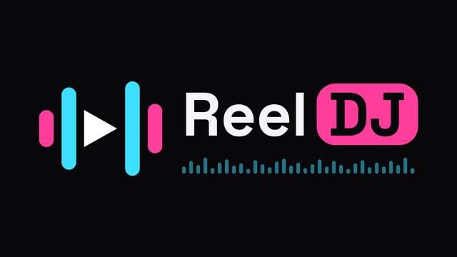

# ReelDJ



A Stremio-compatible streaming app for Android phones, tablets and Android TV, with a Moviebox-style interface, watch tracking and an episode calendar.

## Features

- **Stremio addons** – install any addon by URL (the link Stremio's "Share addon" gives you) or by opening a `stremio://` link. Catalogs, metadata, streams and subtitles all come from your addons. Cinemeta and OpenSubtitles are installed by default.
- **Real-Debrid** – works through your debrid-configured addon. Optionally add your RD API token to see account status and play files already in your RD downloads.
- **Home** – rotating hero banner, All / Movies / TV Shows filter, Continue Watching (with "Up next" episodes), New Episodes, and every catalog as a row.
- **Browse** – one long scrolling grid per catalog with genre filters; more loads as you scroll.
- **Upcoming** – calendar of coming and recently aired episodes for shows in My List or that you've watched, grouped by date, with NEW / premiere badges.
- **Watch tracking** – progress saved every few seconds; titles count as watched at 90%. Mark episodes, whole seasons or movies watched by hand (long-press an episode, or use the circle).
- **My Stuff** – My List and Watch History.
- **Player** – ExoPlayer (Media3) with the FFmpeg audio decoder (DTS, TrueHD, E-AC3, etc.) and LibVLC built in. "Auto" starts with ExoPlayer and switches to VLC if the file won't play. Audio/subtitle track picker, resize modes, resume, external-player handoff.
- **Android TV** – leanback launcher entry, side navigation rail, D-pad focus on everything, remote seek (left/right) and media keys in the player.

Torrent-only (P2P) streams are hidden for now.

## Install

Download an APK from the **Actions** tab (latest run → *ReelDJ-apks*) or from **Releases**:

| File | For |
|---|---|
| `ReelDJ-arm64-v8a.apk` | Most phones, tablets, Shield, Chromecast with Google TV, newer Fire TV |
| `ReelDJ-armeabi-v7a.apk` | Older / 32-bit TV boxes and Fire TV Sticks |
| `ReelDJ-universal.apk` | Works everywhere (bigger) |

## Build

```
./gradlew assembleRelease
```
APKs land in `app/build/outputs/apk/release/`. Push a tag like `v0.1.1` to publish a GitHub release automatically.

The release signing key (`app/cinedeck-release.jks`, password `cinedeck`) is committed on purpose so every build installs over the previous one. Don't reuse it for anything else.


Space Grotesk font: SIL Open Font License (see `third_party/`).
